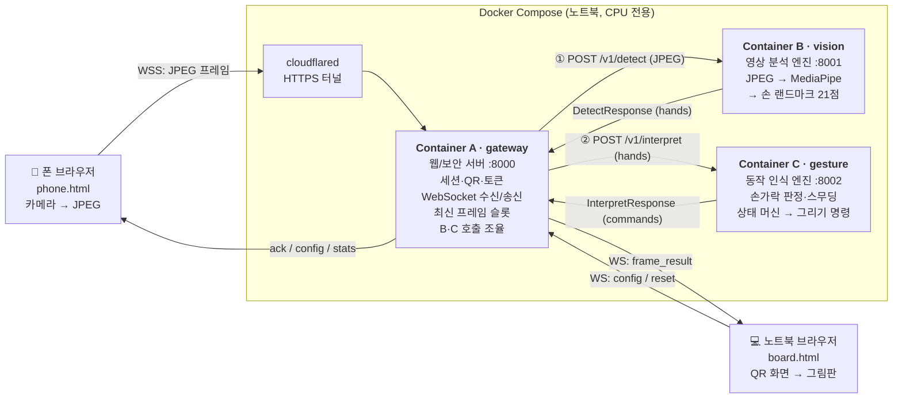

# Gesture Remote Drawing — 실시간 손동작 인식 원격 그림판

노트북 브라우저에 뜬 **QR을 폰으로 스캔**해서 연결하면 브라우저가 **그림판**으로 바뀝니다. 이제 폰 카메라 앞에서 손가락을 움직이면 그림판에 선이 실시간으로 그려집니다.
**GPU 없이 CPU만으로** 동작하며(MediaPipe Hand Landmarker), Docker 컨테이너 3개(A·B·C)로 나뉘어 있습니다.

```
① 기기 페어링 (QR 스캔)  →  ② 실시간 영상 스트리밍  →  ③ 원격 드로잉 및 제어
```

## 빠른 시작

```bash
cp .env.example .env
docker compose up -d --build
```
1. 노트북에서 http://localhost:8000 을 열면 **QR 연결 화면**이 나옵니다.
2. 폰으로 QR을 스캔하고 **카메라 시작**을 누릅니다.
3. 연결되면 브라우저가 **그림판**으로 바뀝니다. 손을 비추고 그리세요.

> 폰 카메라는 HTTPS에서만 동작합니다. QR에는 cloudflared가 만든 `https://…trycloudflare.com` 주소가 들어갑니다.
> QR 아래에 "터널 주소 확인 중"이 계속 보이면 `docker compose logs cloudflared | grep trycloudflare`로 주소를 찾아 `.env`의 `PUBLIC_URL`에 넣으세요.

### 제스처

| 손 모양 | 동작 |
|---|---|
| ☝️ 검지만 폄 | 그리기 |
| ✌️ 검지 + 중지 | 커서만 이동 (펜 올림) |
| ✋ 다섯 손가락 | 지우개 |
| 🤟 검지 + 중지 + 약지 | 다음 색 |
| ✊ 주먹 1.5초 유지 | 전체 지우기 |
| 🤏 엄지를 옆으로 벌리고 검지와 핀치 | 확대·축소 (벌리면 확대, 오므리면 축소, 1~4배) |

> 그릴 때는 엄지를 접으세요. 엄지를 옆으로 벌리면 핀치(확대·축소)로 인식합니다. 키보드 `0`을 누르면 원래 크기로 돌아갑니다.

---

## 컨테이너 설계도



```
                       ┌──────────────────── Docker Compose (노트북, CPU) ────────────────────┐
 📱 폰  ──WSS JPEG──▶  │ cloudflared ──▶ ┌──────────────┐ ① /v1/detect   ┌──────────────┐   │
 (phone.html)  ◀─ack── │                 │  A gateway   │──────────────▶│  B vision    │   │
                       │                 │  :8000       │◀── hands ─────│  MediaPipe   │   │
 💻 노트북 ◀─WS────────│─ frame_result ──│  세션·QR·WS   │               └──────────────┘   │
 (board.html)          │   localhost     │  B·C 조율     │ ② /v1/interpret┌──────────────┐   │
                       │                 │              │──────────────▶│  C gesture   │   │
                       │                 └──────────────┘◀── commands ──│  규칙·상태머신 │   │
                       │                                                └──────────────┘   │
                       └───────────────────────────────────────────────────────────────────┘
```

| 컨테이너 | 역할 | 입력 → 출력 | 상태 | 포트 |
|---|---|---|---|---|
| **A gateway** | 사람(폰·PC)과 만나는 유일한 창구 | 폰 JPEG → B·C 호출 → 그림판에 `frame_result` | 세션, WS 연결, 최신 프레임 슬롯, 통계 | 8000 (호스트 공개) |
| **B vision** | "보는 것"만: 이미지 → 손 좌표 | JPEG → 21개 랜드마크 (0~1 정규화) | 세션별 MediaPipe 추적 인스턴스 | 8001 (내부) |
| **C gesture** | "판단"만: 손 좌표 → 그리기 명령 | 랜드마크 → 제스처 + `stroke_*`/`clear`/`set_color`/`zoom` | 세션별 필터·디바운스·현재 획 | 8002 (내부) |

**핵심 설계 결정**
- **A가 조율**: A가 B와 C를 차례로 부릅니다. B와 C는 서로를 몰라서 각자 단독으로 테스트할 수 있습니다. 슬라이드의 A→B→C→A 화살표는 이 데이터 흐름을 나타냅니다.
- **최신 프레임만 처리**: 처리 중에 새 프레임이 오면 이전 프레임은 버립니다. 그래서 CPU가 밀려도 지연이 쌓이지 않습니다.
- **좌표는 모두 0~1 정규화**: 해상도와 무관합니다. 좌우 반전(전면 카메라)은 C에서 한 번만 적용합니다.
- **보안**: QR URL에 페어링 토큰을 넣고, 세션당 폰은 1대만 허용합니다. B와 C는 외부에 노출되지 않으며, 프레임은 디스크에 저장하지 않습니다.

**측정값** (노트북 CPU, `docker compose` 기준)

| 항목 | 값 |
|---|---|
| B MediaPipe 추론 | 약 14ms/프레임 (첫 프레임만 약 105ms, 모델 초기화) |
| A→B→C 서버 내부 지연 (mock B) | 약 13ms, 15fps, 버린 프레임 0 |

---

## 메시지 계약 요약

전체 계약은 **[docs/03-messages.md](docs/03-messages.md)**, 코드는 [`shared/schemas.py`](shared/schemas.py), 예제는 [`shared/samples/`](shared/samples/)에 있습니다. 두 파일은 항상 함께 수정하고, 계약을 바꾸는 커밋에는 `[contract]`를 붙여 팀원 3명이 모두 확인합니다.

| 구간 | 방식 | 메시지 |
|---|---|---|
| board → A | REST | `POST /api/sessions` → `{session, phone_url, qr_url}`, `GET /api/sessions/{s}/qr.png` |
| phone ↔ A | WS `/ws/phone?s=&t=` | → `hello`, **JPEG 바이너리** / ← `config`, `ack{seq}`, `stats` |
| board ↔ A | WS `/ws/board?s=` | ← `session`, `phone{connected}`, **`frame_result`**, `stats` / → `config`, `reset` |
| A → B | `POST /v1/detect` | body = JPEG, 헤더 `X-Session` `X-Seq` `X-Ts-Ms` → `DetectResponse{hands[{landmarks[21]}]}` |
| A → C | `POST /v1/interpret` | `InterpretRequest{session, seq, t_ms, hands, config}` → `InterpretResponse{gesture, cursor, commands}` |
| C → board (A가 전달) | `commands[]` | `stroke_begin` / `stroke_point` / `stroke_end` / `set_color` / `clear` / `zoom` |

**흐름 제어**: 폰은 ack를 받지 못한 프레임이 2개면 캡처를 건너뜁니다. A는 세션마다 최신 프레임 1칸만 보관합니다.

---

## 3인 분업

자세한 타임라인과 Git 규칙은 **[docs/04-team-plan.md](docs/04-team-plan.md)** 에 있습니다.

| | 팀원 1 — 연결 | 팀원 2 — 눈 | 팀원 3 — 두뇌와 손 |
|---|---|---|---|
| 담당 | **A gateway**, cloudflared, compose, `phone.html` | **B vision** (MediaPipe) | **C gesture** + 그림판 렌더링 `board.js` |
| 브랜치 | `feat/gateway` | `feat/vision` | `feat/gesture` |
| 계약 | §2~§4 | §6 | §5, §7 |
| 혼자 개발하는 법 | `VISION_BACKEND=mock` + `tools/fake_phone.py` | `docker-compose.dev.yml` + `tools/replay_landmarks.py` | `pytest` + `shared/samples/` + mock B |

```bash
# 팀원 1: B를 가짜 손으로 바꾸고, 폰 없이 프레임 송출
VISION_BACKEND=mock docker compose up -d --build
python tools/fake_phone.py --phone-url "<QR 아래 주소>"

# 팀원 2: B·C 포트를 열고 웹캠 → B → C 직접 호출
docker compose -f docker-compose.yml -f docker-compose.dev.yml up -d --build b-vision c-gesture
python tools/replay_landmarks.py --src 0

# 팀원 3: 규칙·상태 머신 단위 테스트, 계약 샘플 재생성
cd services/c_gesture && python -m pytest tests
python tools/make_samples.py && python -m pytest tests
```
도구는 호스트에서 실행합니다. 필요한 패키지는 `pip install -r requirements-dev.txt`로 설치합니다.

---

## 폴더 구조

```
gesture-remote-drawing/
├── README.md
├── docker-compose.yml          # 전체 실행: a-gateway · b-vision · c-gesture · cloudflared
├── docker-compose.dev.yml      # 개발용: B·C 포트를 호스트에 공개 (A 없이 직접 호출)
├── .env.example                # 환경변수 예시 → cp .env.example .env
├── requirements-dev.txt        # 호스트에서 테스트·도구 실행용 패키지
│
├── docs/
│   ├── 01-architecture.md      # 전체 구조와 설계 결정
│   ├── 02-containers.md        # 컨테이너별 역할 · 제스처 규칙표 · 환경변수
│   ├── 03-messages.md          # 메시지 계약 (REST · WebSocket · HTTP · 그리기 명령)
│   └── 04-team-plan.md         # 3인 분업 · 타임라인 · Git 규칙
│
├── shared/                     # 세 컨테이너가 같이 쓰는 코드 (각 이미지에 복사됨)
│   ├── schemas.py              # 메시지 계약 (pydantic). 03-messages.md 와 항상 함께 수정
│   ├── fake_hand.py            # 가짜 손 랜드마크 21개 생성 (mock B · C 테스트 · 샘플)
│   └── samples/                # 계약 예제 JSON (tools/make_samples.py 로 생성)
│
├── services/
│   ├── a_gateway/              # Container A — 웹/보안 서버 :8000
│   │   ├── app/
│   │   │   ├── main.py         # REST(/api/sessions, QR) · WebSocket(/ws/phone, /ws/board)
│   │   │   ├── sessions.py     # 세션 · 페어링 토큰 · 최신 프레임 슬롯 · 통계
│   │   │   ├── pipeline.py     # 프레임마다 B → C 호출 후 그림판에 frame_result 전송
│   │   │   └── tunnel.py       # cloudflared 터널 주소 조회 (QR 에 넣을 HTTPS 주소)
│   │   └── static/
│   │       ├── phone.html      # 폰 페이지: 카메라 → JPEG → WebSocket
│   │       ├── board.html      # 그림판 레이아웃 · QR 화면
│   │       └── board.js        # 그리기 명령 실행 · 곡선 보간 · 확대/축소 · 커서 · undo
│   │
│   ├── b_vision/               # Container B — 영상 분석 엔진 :8001
│   │   └── app/
│   │       ├── main.py         # POST /v1/detect (JPEG → 손 랜드마크)
│   │       └── detector.py     # MediaPipe Hand Landmarker / mock(가짜 손)
│   │
│   └── c_gesture/              # Container C — 동작 인식 엔진 :8002
│       ├── app/
│       │   ├── main.py         # POST /v1/interpret · 세션 reset/삭제 · 오래된 세션 정리
│       │   ├── rules.py        # 손가락 펴짐 비율 · 엄지 벌어짐 · 핀치 거리 → 제스처 분류
│       │   ├── filters.py      # One Euro 필터 (커서 · 핀치 떨림 제거)
│       │   └── state.py        # 세션별 상태 머신: 디바운스 → 커서 → 획 · 확대 · 전체 지우기 명령
│       └── tests/
│           ├── test_rules.py   # 제스처 판정 · 상태 머신 · 확대/축소 단위 테스트
│           └── test_api.py     # HTTP API 테스트 (계약 샘플 사용)
│
├── tests/
│   └── test_samples.py         # shared/samples 가 스키마에 맞는지 검사
│
└── tools/                      # 호스트에서 실행하는 개발 도구
    ├── fake_phone.py           # 폰 없이 A 에 프레임 송출
    ├── check_a.py              # A 통합 체크리스트 자동 점검
    ├── replay_landmarks.py     # 웹캠 → B → C 직접 호출, 결과를 창에 표시
    └── make_samples.py         # shared/samples/*.json 생성
```

각 서비스 폴더에는 `Dockerfile`과 `requirements.txt`가 있습니다 (트리에서는 생략).

| 경로 | 내용 | 담당 |
|---|---|---|
| `docs/` | [01 아키텍처](docs/01-architecture.md) · [02 컨테이너](docs/02-containers.md) · [03 메시지](docs/03-messages.md) · [04 분업](docs/04-team-plan.md) | 공동 |
| `shared/schemas.py`, `shared/samples/` | 메시지 계약 (pydantic) + 예제 | 공동 |
| `shared/fake_hand.py` | 가짜 손 랜드마크 (mock B·테스트·샘플) | 3 |
| `services/a_gateway/app/` | `main.py`(API·WS), `sessions.py`(세션·프레임 슬롯), `pipeline.py`(B·C 조율), `tunnel.py` | 1 |
| `services/a_gateway/static/` | `phone.html`(1), `board.html`(레이아웃 1), `board.js`(렌더링 3) | 1·3 |
| `services/b_vision/app/` | `main.py`(`/v1/detect`), `detector.py`(MediaPipe / mock) | 2 |
| `services/c_gesture/app/` | `rules.py`(손가락 판정), `filters.py`(One Euro), `state.py`(상태 머신), `main.py` | 3 |
| `tools/` | `fake_phone.py`(1), `replay_landmarks.py`(2), `make_samples.py`(3) | |
| `docker-compose.yml`, `docker-compose.dev.yml`, `.env.example` | 실행 설정 (환경변수 설명: [02-containers.md](docs/02-containers.md)) | 1 |
